# Aide 数据工作台演示

## 一次真实采集的本地演示

<picture>
  <source media="(prefers-color-scheme: dark)" srcset="animation/demo-dark.svg">
  
</picture>

[查看双主题动画](animation/preview.html) · [采集数据](animation/run.json) · [采集与生成方法](animation/README.md)

动画读取真实执行 Demo 状态机所得的 JSON；显示的毫秒数仅衡量本机处理与渲染字符串生成，不是大模型推理或生产任务耗时。灰色旁白用于解释，输出与状态变化来自采集记录。动画播放节奏经过编排，启用“减少动态效果”时显示静态完整结果。

- `index.html`：数据需求从口径确认、方案、开发、测试到模拟发布与首跑验收的交互演示。
- `product-explainer.html`：产品介绍、协作对比与持续演进的画面说明。“理解需求”以两张关联卡片展示 Meego 业务原话如何转为业务目标与负责人待确认问题。
- `product-explainer-detail.html`：详细产品动线说明。

## 上线后的持续演进

需求交付后，演示会保存带版本的交付说明书。需求是归档单位，数据表和任务是检索入口。说明书记录业务口径、产物、来源版本与验收证据；历史说明书不会被后续修改覆盖。

新建需求时可直接描述业务变化，或从 Meego（飞书项目）的演示工作项发起。Agent 根据需求正文识别相关表和任务，自动召回历史交付说明书，展示引用口径和待确认事项；用户确认上下文后，再创建关联变更。无需先进入交付知识手动检索。

以“渠道日报增加店铺维度”为例，变更仍须完成确认、测试、明确授权模拟发布和首跑验收，之后产生下一版说明书。交付知识入口保留，用于主动查看与追溯历史版本。

## 任务运维与数据治理旁路

总览有两张入口卡片：任务运维从固定在 2026-10-12 的虚构渠道日报延迟告警出发，数据治理从虚构的 `ads_channel_trade_di` 指标反馈出发。两者都优先检索当前最新的渠道日报交付说明书，展示快照 ID、版本、交付目标、口径、产物、负责人和上游来源；没有对应交付时使用明确标注的历史演示归档。页面区分说明书中的继承事实与虚构事件的诊断假设。

运维入口按任务实例展示业务日期、计划触发、提交/开始/结束、运行类型、状态、队列和重试次数，并提供依赖、延迟分析、日志与记录视图。合成案例中，2026-10-11 退款上游因 worker 节点失联失败，订单上游已成功，日报等待退款依赖；另有独立运行中、历史成功、未来未到计划时间的实例。延迟分析把上游执行、排队、依赖等待和下游业务交付目标分开，09:15 仅是固定观测时点。

选择失败的退款实例后，Agent 将当前实例日志与历史交付说明书分开展示。用户需先完成合成的队列恢复及无活跃尝试核验，再展开精确范围，确认仅重试该实例及业务日期分区、并发 1、不会自动重跑下游。界面依次显示上游重试、日报依赖重评、下游完成，并要求独立复核分区、样本质量与 SLA；最终成功仍记录 09:00 目标逾期。等待依赖、运行中、已成功和未到计划时间的实例不可重试。每次操作记录绑定实例与来源快照，旧版未绑定实例的历史记录保留为只读。提案确认前若来源快照变化，必须重新分析；已启动的模拟沿已确认快照继续审计。

治理示例仍归档待确认口径或质量排查清单，不直接批准新定义。需要改表结构或指标口径时，使用关联变更需求回到原有确认、开发、测试、发布授权链路。所有运维动作均为本地模拟，不执行真实调度、重跑或回填；已接受快照不会被覆盖。

## Meego 关联

绑定演示项目后选择虚构的 Meego 工作项，可体验来源条目与交付需求的关联。同一来源条目重复发起会回到已有需求。Meego 描述与历史交付说明书分别保留，便于区分当前需求和历史依据。

绑定后，页面打开期间每分钟自动检查演示工作项，首页提示新发现、待确认接入的需求数量。打开或预览不会清除待确认状态；确认接入后复用原有需求流程。重复检查和刷新不会重复创建需求。

此绑定仅在本地模拟，不建立真实飞书授权，不读取真实工作项，也不向飞书回写状态。粘贴链接不代表已导入内容，需补充需求正文。产品概念参考[飞书项目：一个项目的全流程](https://project.feishu.cn/b/helpcenter/1ykiuvvj/4ek1avnv)，不声称已实现任何官方 API 集成。

## 演示边界

数据与人物均为虚构。状态保存在当前浏览器，成员切换用于演示协作；知识检索与上下文组装在本地模拟。历史演示归档与本次模拟首跑验收产生的说明书分别标注。

本页面不连接真实大模型、Meego API、Hive、生产调度或在线多人身份服务。样本测试不执行用户编辑的 SQL；演示产物不构成生产执行或数据交付证明。

直接打开 HTML，或在本目录使用静态文件服务器浏览即可。页面不需要安装依赖，也不改变 Mino 的本地服务和一键启动流程。
