# Aide 工作台操作时间线




[双主题预览和重新播放](preview.html)

这两张 SVG 由同一份 [`run.json`](run.json) 生成。采集脚本在 Node VM 中加载 `../index.html` 的 Aide、AideKnowledge 和 AideSidepaths 源代码，执行固定的虚构运维案例：定位失败的退款实例、查看延迟与日志、生成建议、拦截提前确认、完成前置核验、确认模拟重试、推进上下游，最后独立复核。它记录每一步的处理函数返回值、页面文字与状态、提示文字、前后快照和本地耗时。SVG 的命令行是采集事件；`返回`与`页面新增`来自记录，右侧灰色文字是根据状态生成的旁白。底部删除线与新增文字通过前后 `phaseLabel` 的字符差异计算。

在本目录的上一层运行：

```bash
node animation/capture.cjs
node animation/generate.cjs
```

生成器仅使用 Node 内置模块，产出自包含的浅色和深色 SVG。每轮动画播放 18 秒并循环，最后保留完整画面；逐行出现节奏为了阅读，不按捕获的毫秒数缩放。系统设置为减少动态效果时，全部内容静态可见。可以直接打开 `preview.html` 查看两版，或用其按钮重新播放。可在其他 Markdown 文档中插入 ``。

时间由 `performance.now()` 在本机记录，保留到 0.001 毫秒。每行右端的逐步耗时包含操作函数、页面渲染及采集脚本的检查开销；部分行的小字分别列出操作函数和页面渲染/文字提取耗时，其余行显示采集到的提示。时间反映这次 Node VM 本地模拟，不能推断浏览器交互、网络、生产调度、重跑或回填时延。`run.json` 的 `productionTimingMs` 为 `null`，SVG 明示“生产耗时 未采集”。业务数据、实例和人物均为演示样本；最终复核归档也是本地状态推进，不代表真实生产执行或数据交付。

SVG 中较长的返回与页面新增内容使用带省略号的摘录；完整前后页面文本、原始 HTML、状态、提示和精确数值均在 `run.json`。如源页面变化，先重新采集，再重新生成，避免把旧事件误当成当前结果。
